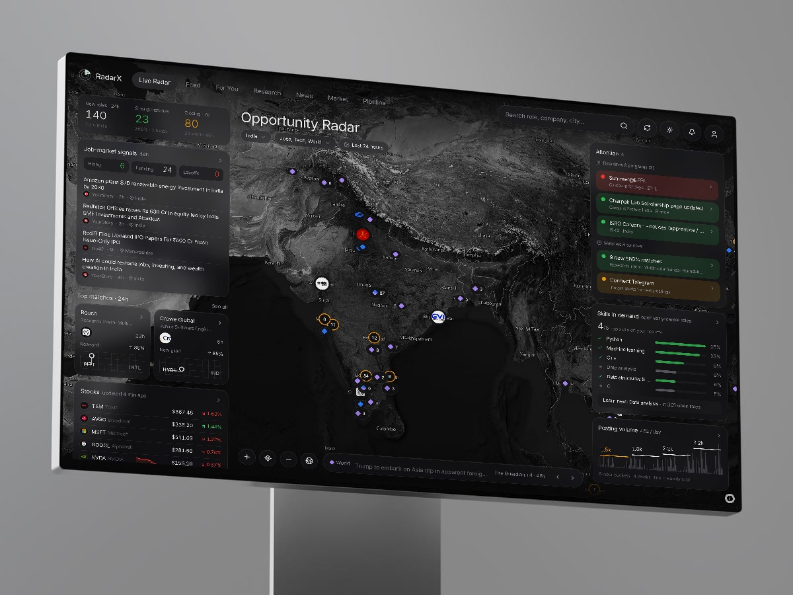
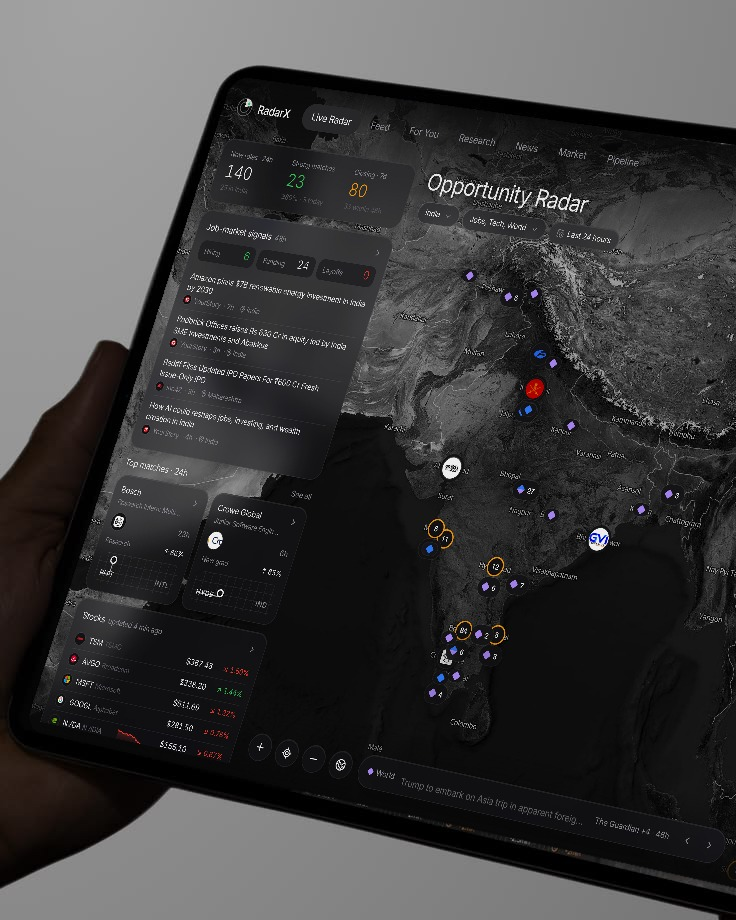
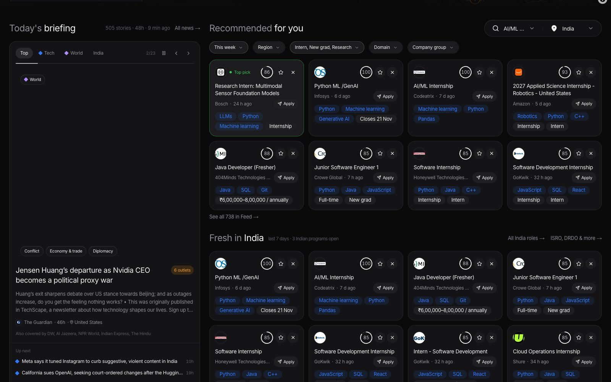
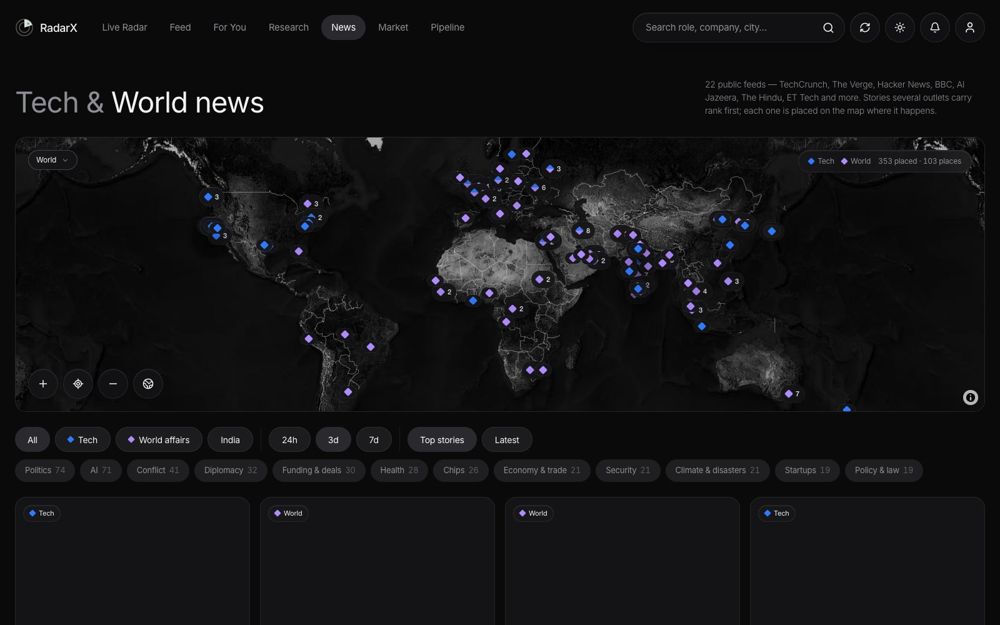
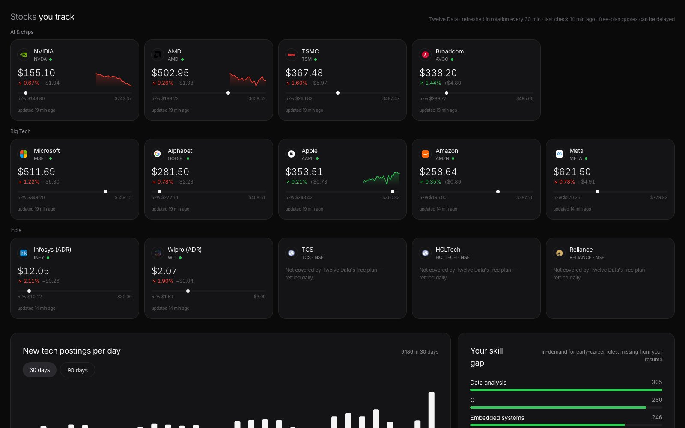
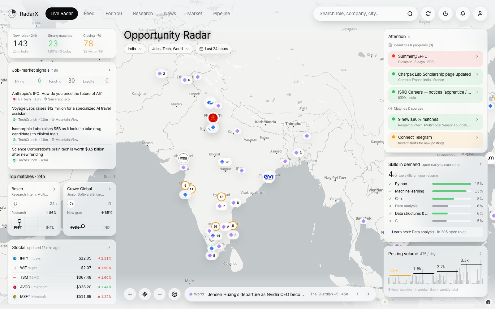
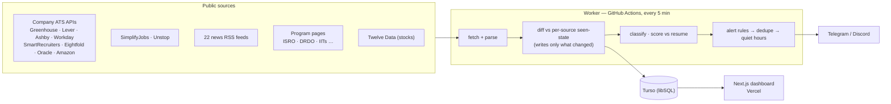

<div align="center">


# RadarX

**Internships, new-grad and research roles — the moment they're posted.**
Polls ~330 company career sites and public job APIs every 5 minutes, ranks every role against your resume,
pings you on Telegram, and puts it all — plus tech news, world affairs and the stocks that move hiring — on a live map.




</div>

---

## Why

Good internships fill within hours of posting. Aggregators show them days later. RadarX goes **straight to the source** — each company's own applicant-tracking system (Greenhouse, Lever, Ashby, Workday, SmartRecruiters, Eightfold, Oracle, Amazon) plus public feeds — and tells you within minutes, with a match score that says whether it's worth your evening.

India gets equal footing: Indian companies, India-filtered searches on global boards, Unstop, and **government & research programs** (ISRO, DRDO, IIT/IISc fellowships…) watched for page changes.

<table>
<tr>
<td width="58%"></td>
<td>

### What's on the Live Radar

- **Full-screen live map** — every new role in the last 24 h pinned by city, with tech-news ◆ and world-affairs ◆ layers
- **Glass widgets** — new roles today, strong resume matches, deadlines closing this week
- **Job-market signals** — hiring, funding and layoff news
- **Skills in demand** vs. your resume, with "learn next"
- **Attention** — closing programs, changed pages, failing sources
- **Stocks** — NVIDIA, TSMC, Big Tech and Indian IT, with 30-day sparklines
- **Today's briefing** — one rotating story card, ranked by how many outlets carry it

</td>
</tr>
</table>

<p align="center">
  
  
</p>
<p align="center">
  
  
</p>

## Features

| | |
|---|---|
| ⚡ **Speed from source** | ~330 companies across 8 ATS types + SimplifyJobs + Unstop, polled every 5 min with ETags, backoff and polite rate limits |
| 🎯 **Resume match 0–100** | Upload a PDF → ~190-skill taxonomy → every role scored on skills, title, level and region |
| 📣 **Alerts** | Telegram (and Discord) with rules: levels, regions, min score, quiet hours (IST), top-N + summary, dedupe across sources |
| 🇮🇳 **India first-class** | Indian companies, India facets on Workday/Eightfold/Amazon, Unstop (stipends + deadlines), 32 research programs with a page-change watcher |
| 🗺️ **Live map** | MapLibre + grayscale Sentinel-2 satellite (dark) / Positron (light), city clusters, hover cards |
| 📰 **News** | 22 public RSS feeds (TechCrunch, Verge, HN, BBC, Al Jazeera, The Hindu, ET Tech…), geolocated and clustered by story |
| 📈 **Market** | Posting volume, skill demand & gaps, top hiring companies, stock watchlist |
| 🗂️ **Pipeline** | Drag-and-drop board: saved → applied → interviewing → offer |

## Architecture



The worker keeps a compact **seen-state per source** (id → fingerprint, last seen, misses) in one key-value row, so a poll only reads/writes the postings that actually changed — about **150 rows written per run** instead of 39 000. That's what keeps a 5-minute poller inside free database tiers.

## Run it locally (free, forever)

```bash
git clone https://github.com/<you>/RadarX && cd RadarX
npm install
cp .env.example .env.local        # everything is optional for a first run
npm run worker -- --once          # first poll: stores everything silently (no alert flood)
npm run dev                       # → http://localhost:3000
```

Then, in the dashboard's **Settings**: upload your resume, set alert rules, connect Telegram (`npm run telegram:setup`).
Keep it fresh with `npm run worker -- --loop` (polls every 5 min).

<details>
<summary><b>All worker commands</b></summary>

| Command | What it does |
|---|---|
| `npm run worker -- --once` / `--loop` | one poll / poll every `POLL_INTERVAL_MIN` |
| `--discover [--all]` | find the ATS for companies set to `auto` |
| `--health` | source status table |
| `--news` · `--programs` · `--stocks [--demo]` | refresh one subsystem now |
| `--enrich [N]` | fetch missing descriptions (better match scores) |
| `--only stripe,greenhouse` | restrict a run |
| `RADAR_DB_STATS=1` | print rows written/returned per run |
| `npm run probe` | hit every ATS type and report what works |
| `npm test` · `npm run typecheck` | 131 tests (fixture-based parsers, classifier, dispatch, news, stocks, security) |

</details>

## Deploy for ₹0 (Turso + Vercel + GitHub Actions)

1. **Database — [Turso](https://turso.tech)** (free: 5 GB, 500 M rows read, 10 M rows written / month)
   ```bash
   turso db create radarx && turso db show radarx --url && turso db tokens create radarx
   DATABASE_URL=libsql://… DATABASE_AUTH_TOKEN=… npm run db:push   # copies your local data up
   ```
2. **Worker — GitHub Actions.** Push this repo (public repos aren't billed for Actions minutes), then add repository **secrets**:
   `DATABASE_URL`, `DATABASE_AUTH_TOKEN`, `TELEGRAM_BOT_TOKEN`, `TELEGRAM_CHAT_ID`, and optionally `DISCORD_WEBHOOK_URL`, `TWELVEDATA_API_KEY`.
   [`.github/workflows/worker.yml`](.github/workflows/worker.yml) runs every 5 minutes, never overlaps itself, and re-enables itself weekly (GitHub pauses idle scheduled workflows after 60 days).
3. **Dashboard — [Vercel](https://vercel.com)** (Hobby: personal, non-commercial). Import the repo, set `DATABASE_URL` + `DATABASE_AUTH_TOKEN` and **`DASHBOARD_PASSWORD`** — every page and action then needs that password, so a public URL doesn't expose your data or settings. `DASHBOARD_URL` adds "Open in RadarX" buttons to alerts. Optional: `GH_DISPATCH_TOKEN` + `GH_REPO` make the **Poll now** button start a worker run.

> **Secrets never live in the repo.** `data/` (your database, resume profile) and `.env*` are git-ignored.
> GitHub's scheduled runs can start late under load — if you want the very fastest alerts, also run `npm run worker -- --loop` on your laptop; both write to the same database.

### Free-tier budget (measured)

| Service | Free allowance | RadarX usage |
|---|---|---|
| Turso writes | 10 M / month | ~150 rows per run + a daily refresh ≈ **2.5 M / month** |
| Turso reads | 500 M / month | ~1–5 k rows per run; heavy scans run every few hours |
| GitHub Actions | unmetered (public repo) | ~288 runs / day, ~1 min each |
| Vercel Hobby | 1 M function invocations | a few thousand page views |
| Twelve Data | 800 credits / day | ~390 (14 symbols, rotated every 30 min) |

## Data & ethics

RadarX only uses **public APIs and public pages** — company ATS endpoints meant for career sites, RSS feeds, and official program pages. It never scrapes LinkedIn, Naukri, Internshala or any site whose terms or robots.txt forbid it, and identifies itself with a polite user agent. News cards show a headline and short summary and link to the publisher. Stock quotes come from Twelve Data's official API.

**Attribution:** satellite imagery © [Sentinel-2 cloudless by EOX](https://s2maps.eu) (contains modified Copernicus Sentinel data, CC BY-NC-SA 4.0 — personal, non-commercial use) · vector tiles © [OpenFreeMap](https://openfreemap.org) / © OpenStreetMap contributors · company logos via Google's favicon service.

## Project layout

```
src/
  app/            Next.js routes — (app)/ Live Radar, Feed, For You, Research, News, Market, Pipeline, Settings
  components/     ui/ primitives · app/ map, widgets, cards, news, stocks, loader
  sources/        ATS parsers (fixture-tested), fetchers, auto-discovery
  worker/         poll pipeline, news, programs, stocks, CLI
  alerts/         Telegram/Discord formatting, rules, dispatch
  lib/            db + migrations, classifier, scoring, queries
  data/           company registry, programs, cities, news feeds, watchlist
tests/            vitest + recorded API fixtures
```

<div align="center"><sub>Built for one student's job hunt. Speed from source is the whole point.</sub></div>
